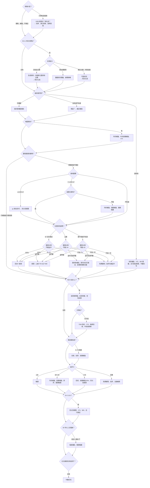

# 不能或不適合都更時的替代方案

- 變體 D 第 2 件。給「我家都更划不划算」試算器（34，`mvp-variants/renewal-calculator/`）讀。
- 正本是 `decision-tree.json`。本檔是給人讀的說明，選項段落照 JSON 寫成。
- 版本 2026-10-22。補助資料日期 2026-10-18（`world-practices/taipei-assistance/`）。
- 驗證：`uv run python -X utf8 research/issue-06/mvp-variants/consent-simulator/decision-tree/scripts/validate_tree.py`
- 這是政策情境參考，不是個案判定。屋齡、規範世代、軟弱層都是推估或候選。風險是相對於臺北其他地方。

## 摘要

1. 樹有 24 個節點、35 個選項、27 個條件變數。條件變數裡 12 個直接讀 `data/marts/`，其餘由屋主在試算器自填。
2. 分流順序：先看硬限制（文資、海砂屋、黃單），再看重建可不可行（基地、更新地區、同意比例），最後看人（高齡、付不付得起）與房子（軟弱層、初評、電梯）。
3. 同意比例是主軸。危老要 100%，自劃都更要超過 4/5，公劃要超過 3/4，§7 迅行劃定只要過半。連耐震初評都要所有權人過半同意。
4. 資料債 9 筆。最卡的是基地面積（地籍）、更新地區範圍圖、初評與 ID 值、文資保存範圍。這 4 筆有了，屋主要自填的題目會少一半【推論】。

## 1. 決策樹（簡化版）

完整的分支與條件看 JSON。這張圖只畫主幹，選項用名稱縮寫。

## 2. 如何讀 JSON（給 34）

### 2.1 頂層

| 鍵 | 內容 |
|---|---|
| `version` | `2026-10-22` |
| `disclaimer` | 頁尾要顯示的一段話 |
| `inputs` | 條件變數。試算器的表單從這裡長出來 |
| `nodes` | 條件節點。`nodes[0]`（`n_goal`）是起點 |
| `options` | 替代方案 |
| `data_debts` | 資料缺口，S4 用 |

### 2.2 inputs

- `type`：`bool`、`enum`、`number`。`enum` 的選項在 `values`（`value` 給程式、`label` 給人）。
- `source_field`：`data/marts/` 的欄名（多在 `building_points`，見 `source_table`）。有值就從地址查詢的分片帶入。`null` 代表資料層沒有，要屋主自填，填法寫在 `how_user_provides`。
- `user_only: true`：本來就該問屋主（例如想做什麼、願意比例）。不算資料債。
- `display_only: true`：不參與分流，只在畫面上顯示（例如 `doorplate_units` 當「危老要這 N 戶全部同意」）。
- `hint_field`：只能當提示的欄位。例如 `owner_age_65plus` 的提示是里層級 `share_65plus`，不能拿來當逐棟事實。
- 資料層空白一律當 `null`，不要當 `false` 或 `none`。海砂屋、黃單只帶在精確比對到門牌的棟，空白不代表沒有列管。

### 2.3 nodes 與 branches

每個節點問一題（`question`），看一個變數（`input_id`），依序比對 `branches`：

1. **由上往下，第一個符合的分支就用它。**
2. `when` 是物件：
   - `{"op": "eq", "value": x}`、`{"op": "in", "values": [...]}`
   - 數字：`gt`、`gte`、`lt`、`lte`，值在 `value`
   - `{"op": "is_null"}`：屋主沒填、資料層也沒有
   - `{"op": "else"}`：其他全部（含 null），一定放最後
3. 符合後：
   - `option_ids`：把這些選項加進結果（可能是空陣列）。
   - `next`：接著走這個節點。沒有 `next` 就結束。
   - 兩個都有時，先收選項，再往下走。
   - `note`：可以直接顯示的一句提醒。
4. 每個節點都有 `is_null` 或 `else`，所以資料不齊也走得完。驗證程式保證沒有迴圈、沒有走不到的節點。

### 2.4 options

- 收集完之後去重，依 `card_order` 排序（對應 `next-step-card.md` 卡片表的「順序」；`null` 排最後）。
- `excluded_when`：任一條成立就不顯示，或灰掉並顯示 `reason`。例如基地內有已指定古蹟時排除危老；海砂屋排除市府結構補強。比對規則同 `when`；變數是 `null` 時不排除。
- `amount`、`deadline_or_period` 是 `null` 時，畫面顯示「請洽窗口確認」，不要顯示【待確認】（照卡片表顯示規則第 5 條）。
- `deadline_date` 是 ISO 日期，給「快截止」標籤用（距今 60 天內）。
- `caveats`、`pending`：展開後才顯示的注意事項與待確認。
- `required_fields`：判斷這個選項要用到哪些變數。試算器可以用它提示「補填這幾題，結果會更準」。

### 2.5 走一遍的例子

萬華一棟 4 層公寓，推估 1978 年建成（`g2_1974_1982`），沒電梯，不是軟弱層候選；屋主想重建，基地 300 m²，不能整合鄰地，不在更新地區，估計 60% 願意，家裡有長輩、付不起：

`n_goal`（重建）→ `n_heritage_precheck`（沒有）→ `n_sea_sand`（null）→ `n_sea_sand_suspect`（null）→ `n_quake_listed`（null）→ `n_goal_gate` → `n_site_area`（<500，草案提醒）→ `n_merge`（不行：市府補強、弱層補強、整建維護）→ `n_renewal_area`（不知道，用 4/5）→ `n_consent_self`（過半未達 4/5：更新會補助、請市府迅行劃定、區權會重建決議）→ `n_elderly`（長照無障礙、扶老修繕、老宅延壽）→ `n_afford`（7599、575、融資信保、中低收修繕）→ `n_soft_story` → `n_seismic_score`（沒做：免費顧問、初評、主動輔導）→ `n_seismic_id` → `n_elevator`（是）→ `n_floors`（4 層：電梯補助、整建維護）→ `n_relocation`。

之後 `excluded_when` 會排掉：7599（基地未滿 2,000 m²）、主動輔導（未滿 6 層）。575 留著，但它要求海砂屋、紅黃單或 ID＜0.35，畫面要把「誰能申請」寫清楚。

## 3. 選項

共 35 個。順序同 JSON。「出處」都是 repo 內路徑；原始網址在那些檔案裡。

### 危老推動師與重建工作站（免費諮詢）（`opt_free_consultant`）

- **是什麼**：推動師或工作站免費說明你家能不能走危老、要準備什麼。
- **誰能申請**：任何臺北市屋主。
- **金額**：免費（推動師由市府付輔導費）
- **截止日**：常態
- **為什麼適合**：還不知道走哪條路、同意人數不夠，或判不出屋齡時，先找不用錢的人談。
- **待確認**：法源名稱 repo 內沒有整理。
- **法源**：無（不是法定申請方案）或 repo 內沒有整理
- **出處**：`research/issue-06/world-practices/taipei-assistance/report.md` §1 總表 RE#2；`research/issue-06/world-practices/taipei-assistance/next-step-card.md` 卡片表第 1 列；`research/issue-06/world-practices/taipei-assistance/items/seismic-and-liquefaction.md` 總表第 16 列。證據：【文件】

### 危老耐震初評補助（`opt_seismic_initial_assessment`）

- **是什麼**：專業機構評估整棟耐震能力，給一個分數 R。是補強與危老的入口。
- **誰能申請**：合法建築物；所有權人過半同意；住宅樓地板占 2/3 以上；1999 年底前申請建照。
- **金額**：每棟 1.2 萬元（3,000 m² 以上 1.5 萬元）；屋主實付約 3,000～8,000 元（整棟分攤）
- **截止日**：受理中
- **為什麼適合**：屋齡推估在 1999 年以前、軟弱層候選，或還沒做過評估。有分數才知道該補強還是重建。
- **待確認**：建照日期門檻：SL#1 寫 88-12-29，政策線寫 88-12-31，要回原條文確認。
- **法源**：臺北市危險及老舊建築物加速重建辦法 §8～§10；都市危險及老舊建築物結構安全性能評估辦法 §3（過半同意）
- **出處**：`research/issue-06/world-practices/taipei-assistance/report.md` §1 總表 SL#1；`research/issue-06/world-practices/taipei-assistance/items/seismic-and-liquefaction.md` 總表第 1 列、§1.4；`research/issue-06/city-workflow/2026-10-18-g3-consent-and-parking.md` §1.6。證據：【文件】；自付金額是【推論】

### 主動輔導耐震初評（中央補助、市府主動找上門）（`opt_proactive_assessment`）

- **是什麼**：市府委託評估機構幫大樓做初評，是市府主動徵詢，不是屋主隨時申請。
- **誰能申請**：6 層樓以上、有管理組織，且結構快篩分數高或屋齡 30 年以上。
- **金額**：中央補市府每棟 1.5 萬元＋審查費 1,000 元；屋主免費【推論】
- **截止日**：持續
- **為什麼適合**：6 層以上有管委會的大樓還沒做過初評。
- **法源**：主動輔導辦理建築物耐震能力初步評估及弱層補強經費補助執行作業要點（111-10-17 修正）
- **出處**：`research/issue-06/world-practices/taipei-assistance/report.md` §1 總表 SL#3；`research/issue-06/world-practices/taipei-assistance/items/seismic-and-liquefaction.md` 總表第 3 列、§1.5。證據：【文件】；屋主免費是【推論】

### 危老耐震詳評補助（`opt_detailed_assessment`）

- **是什麼**：比初評細的結構評估，用來判斷補強划不划算。
- **誰能申請**：同初評；多用在初評 30～45 分、要判斷改善是否具效益時。
- **金額**：每棟不超過評估費 30% 或 40 萬元；屋主至少自付約 70%
- **截止日**：受理中
- **為什麼適合**：初評落在 30～45 分，要決定補強還是重建；申請市府補強也要「具改善效益」的證明。
- **待確認**：「30% 或 40 萬」是否取低者。
- **法源**：臺北市危險及老舊建築物加速重建辦法（112-07-21）；中央主管機關補助結構安全性能評估費用辦法（108-06-13）
- **出處**：`research/issue-06/world-practices/taipei-assistance/report.md` §1 總表 SL#2；`research/issue-06/world-practices/taipei-assistance/items/seismic-and-liquefaction.md` 總表第 2 列、§2。證據：【文件】；「30% 或 40 萬」是否取低者【待確認】

### 臺北市結構安全補強補助（`opt_city_retrofit_subsidy`）

- **是什麼**：初評顯示要補強、而且補強划算時，市府補一半工程費。不用拆房子，不用全體同意。
- **誰能申請**：合法建築物、住宅占 1/3 以上；初評乙級但具改善效益，或貼黃單；不是海砂屋、不是單一所有權人。
- **金額**：補 50%，每案最高 1,200 萬元；策略地區、整建住宅等補 80%，最高 2,000 萬元
- **截止日**：受理到 2026-12-31，經費用完提前停
- **為什麼適合**：湊不到重建門檻、基地太小、文資限制不能拆，或初評 30～45 分。
- **法源**：臺北市協助老舊建築物外牆安全整新及結構安全補強補助作業規範（114-12-08）；115 年度受理公告（115-07-01）
- **出處**：`research/issue-06/world-practices/taipei-assistance/report.md` §1 總表 SL#6；`research/issue-06/world-practices/taipei-assistance/next-step-card.md` 卡片表第 3 列；`research/issue-06/world-practices/taipei-assistance/items/seismic-and-liquefaction.md` 總表第 6 列、§3.2。證據：【文件】

### 中央耐震弱層補強（`opt_central_weak_story`）

- **是什麼**：中央的補強補助，針對一樓等弱層。和臺北市補強只能選一。
- **誰能申請**：公寓大廈或住商混合（住宅占 1/2 以上）；初評 R＞30，或詳評須補強，或貼危險標誌。
- **金額**：補 45%，上限 300～450 萬元；初評 R＞45 或詳評須補強：補 85%，上限 450 萬元
- **截止日**：制度持續（中央 115～118 年計畫）；臺北本年度受理期間【待確認】
- **為什麼適合**：軟弱層候選、貼黃單，或初評超過 30 分。R＞45 又不想重建時，補助比例最高。
- **待確認**：中央弱層補強在臺北市本年度的受理期間。
- **法源**：主動輔導辦理建築物耐震能力初步評估及弱層補強經費補助執行作業要點（111-10-17 修正）
- **出處**：`research/issue-06/world-practices/taipei-assistance/report.md` §1 總表 SL#5；`research/issue-06/world-practices/taipei-assistance/next-step-card.md` 卡片表第 4 列；`research/issue-06/world-practices/taipei-assistance/items/seismic-and-liquefaction.md` 總表第 5 列、§3.1。證據：【文件】；臺北本年度受理期間【待確認】

### 都更整建維護補助（電梯、外牆、耐震補強）（`opt_renovation_maintenance`）

- **是什麼**：都更的「整建維護」：不拆房子，補外牆、補強、加電梯。
- **誰能申請**：已報備的管委會、更新會等；公告更新地區要所有權人與面積各超過 3/4 同意，自劃單元各超過 4/5，或區權會決議。
- **金額**：補 50%，最高 1,200 萬元；整宅或策略地區補 80%，最高 2,000 萬元
- **截止日**：受理到 2026-12-31
- **為什麼適合**：基地太小不能整合、初評 30～45 分，或 6 樓以下沒電梯。比重建容易湊同意。
- **法源**：115 年度臺北市都市更新整建維護規劃設計及實施經費補助申請暨審查原則（115-07-01 公告）
- **出處**：`research/issue-06/world-practices/taipei-assistance/report.md` §1 總表 RE#6；`research/issue-06/world-practices/taipei-assistance/next-step-card.md` 卡片表第 11 列；`research/issue-06/world-practices/taipei-assistance/items/rebuild-and-elderly.md` 總表第 6 列、§2.2。證據：【文件】

### 老舊公寓增設電梯補助（`opt_elevator_subsidy`）

- **是什麼**：6 樓以下沒電梯的公寓，加裝電梯的工程補助。
- **誰能申請**：6 樓以下、住宅占 1/2 以上、屋齡 20 年以上的無電梯集合住宅；已領增設電梯建築許可；管委會或過半住戶推派代表申請。
- **金額**：每座補 50%、最高 300 萬元；戶內有 65 歲以上等：補 80%、最高 480 萬元
- **截止日**：受理到 2026-12-31 或經費用完
- **為什麼適合**：30 年以上沒電梯、6 樓以下。高齡戶不想或不能重建時，先解決上下樓。
- **法源**：臺北市協助老舊建築物增設電梯補助作業規範（114-10-31）；115 年度受理公告（115-07-01）
- **出處**：`research/issue-06/world-practices/taipei-assistance/report.md` §1 總表 RE#10；`research/issue-06/world-practices/taipei-assistance/next-step-card.md` 卡片表第 10 列；`research/issue-06/world-practices/taipei-assistance/items/rebuild-and-elderly.md` 總表第 10 列、§3。證據：【文件】

### 危老重建（`opt_weilao_rebuild`）

- **是什麼**：30 年以上、耐震不足的老屋拆掉重蓋，可以多拿容積與稅賦減免。
- **誰能申請**：合法建物，且三擇一：主管機關通知限期拆除或補強；評估未達最低等級；屋齡 30 年以上、耐震不達標，而且改善不具效益或沒有電梯。全體所有權人都要同意。
- **金額**：容積最多 1.3 倍基準容積或 1.15 倍原容積；地價稅、房屋稅減免；時程獎勵已歸零【推論】
- **截止日**：申請期限 2027-05-31；刪除落日的修法還在立法院
- **為什麼適合**：願意比例 100%。基地不必大，但要所有地主都點頭。
- **注意**：全體同意，對不同意的人沒有任何強制機制。基地未滿 500 m²：行政院 2026-07-16 草案擬降上限到 1.2 倍基準容積或 1.1 倍原容積，還沒三讀。核准案中 300 m² 以下失效 24%，500～1,000 m² 只有 12%【實測，G3D】。
- **法源**：都市危險及老舊建築物加速重建條例 §3、§5、§6
- **出處**：`research/issue-06/world-practices/taipei-assistance/report.md` §1 總表 RE#1；`research/issue-06/world-practices/taipei-assistance/next-step-card.md` 卡片表第 5 列；`research/issue-06/city-workflow/n1-parameters.md` 第 2、3、13 列；`research/issue-06/city-workflow/2026-10-18-g3-consent-and-parking.md` §1.1；`research/issue-06/data-patterns/g3-consent-threshold.md` 結果。證據：【文件】；時程獎勵歸零是【推論】

### 都更重建（位於 §7 迅行劃定的更新地區）（`opt_renewal_rapid_designated`）

- **是什麼**：用都更重建。迅行劃定地區的事業計畫只要人數、面積各過半；不同意的人走權利變換。
- **誰能申請**：基地位於依都更條例 §7 迅行劃定的更新地區（重大事變受損、為避免重大災害、或危老 §3 第 1 項第 1、2 款的危險建物）。
- **金額**：查不到【待確認】
- **截止日**：常態（法律規定）
- **為什麼適合**：同意比例過半但湊不到 3/4 或 100%；或海砂屋列管須拆除。
- **注意**：臺北市海砂屋計畫書寫明依 §7 第 1 項第 3 款迅行劃定【文件，只看到搜尋摘要】。耐震不足而有明顯危害公共安全的建物，可準用建築法 §81 強制拆除（§57 第 3 項）。
- **待確認**：容積獎勵依都更容積獎勵辦法個案核定，repo 內沒有一般值。
- **法源**：都市更新條例 §7 第 1 項、§37 第 1 項第 2 款第 1 目、§43、§57
- **出處**：`research/issue-06/city-workflow/2026-10-18-g3-consent-and-parking.md` §1.2；`research/issue-06/city-workflow/n1-parameters.md` 第 15、18 列；§2 末「§7 第 1 項三款」；`research/issue-06/city-workflow/report.md` §5.3。證據：【文件】；容積獎勵金額個案核定【待確認】

### 都更重建（位於公告的更新地區）（`opt_renewal_public_area`）

- **是什麼**：用都更重建。公告更新地區的事業計畫要人數、面積各超過 3/4。
- **誰能申請**：基地位於市府公告的更新地區（§5 公劃、§8 策略性等）。
- **金額**：查不到【待確認】
- **截止日**：常態（法律規定）
- **為什麼適合**：願意比例超過 3/4，但不是 100%，危老做不了。
- **注意**：臺北市 2026-04 擴大公劃更新地區到 93 處，公告原文與文號沒找到【待確認】。
- **待確認**：容積獎勵個案核定。2026-04 擴大公劃更新地區的公告原文。
- **法源**：都市更新條例 §37 第 1 項第 2 款第 2 目、§43、§57
- **出處**：`research/issue-06/city-workflow/2026-10-18-g3-consent-and-parking.md` §1.2、§1.8；`research/issue-06/city-workflow/n1-parameters.md` 第 16 列；`research/issue-06/city-workflow/report.md` §5.3。證據：【文件】；容積獎勵金額【待確認】

### 都更重建（自劃更新單元）（`opt_renewal_self_delineated`）

- **是什麼**：不在劃定地區時，自己劃更新單元申請都更。事業計畫要人數、面積各超過 4/5。
- **誰能申請**：未經劃定地區的基地，依都更條例 §23 自劃更新單元。
- **金額**：查不到【待確認】
- **截止日**：常態（法律規定）
- **為什麼適合**：願意比例超過 4/5，但不是 100%。
- **注意**：臺北市自劃更新單元必須排除已指定古蹟（作業須知第 4 點第 3 款）。更新單元範圍要審：是否完整街廓或達 2,000 m² 等（都更自治條例 §12、§14）；例外條件 repo 未整理【待確認】。
- **待確認**：容積獎勵個案核定。臺北市自劃更新單元的面積基準與例外。
- **法源**：都市更新條例 §23、§37 第 1 項第 3 款
- **出處**：`research/issue-06/city-workflow/2026-10-18-g3-consent-and-parking.md` §1.2；`research/issue-06/city-workflow/n1-parameters.md` 第 17、23 列；`research/issue-06/city-workflow/2026-10-18-site-inspection.md` §2 第 1 列。證據：【文件】；更新單元劃定基準的例外【待確認】

### 自主都更補助（更新會）（`opt_self_renewal_subsidy`）

- **是什麼**：屋主自己組更新會推都更，市府補規劃費。
- **誰能申請**：依都更條例 §22 或 §23 劃定更新單元、以重建為限；申請人是更新會或籌組發起人。立案階段要私有所有權人與面積均過半的事業計畫同意書。
- **金額**：設立更新會上限 80 萬元；事業計畫、權利變換計畫各上限 250 萬元，且各不超過總經費一半；完整街廓或 3,000 m² 以上各提高 20%
- **截止日**：以年度預算為限；115 年餘額【待確認】
- **為什麼適合**：已經過半但還沒到 3/4 或 4/5。事業概要只要過半，可以先立案，邊做邊整合。
- **待確認**：115 年度預算餘額。
- **法源**：臺北市協助民間推動都市更新事業經費補助辦法（109-11-19）；都市更新條例 §22
- **出處**：`research/issue-06/world-practices/taipei-assistance/report.md` §1 總表 RE#5；`research/issue-06/world-practices/taipei-assistance/items/rebuild-and-elderly.md` 總表第 5 列、§2.1；`research/issue-06/city-workflow/2026-10-18-g3-consent-and-parking.md` §1.2 事業概要列。證據：【文件】；115 年餘額【待確認】

### 請市府評估迅行劃定（`opt_request_rapid_designation`）

- **是什麼**：都更條例 §7 第 1 項第 2 款：「為避免重大災害之發生」，市府可以迅行劃定更新地區。劃進去之後，事業計畫門檻從 3/4 或 4/5 降到過半。
- **誰能申請**：不是屋主申請的方案。劃定由市府走都市計畫程序；屋主能做的是向都更處、里長反映【推論】。
- **金額**：查不到【待確認】
- **截止日**：查不到【待確認】
- **為什麼適合**：願意的人過半，但到不了 3/4、4/5。或是 ID＜0.35 的危險建物。
- **待確認**：屋主反映的正式管道。市府是否會依 §7 第 1 項第 2 款劃定。
- **法源**：都市更新條例 §7 第 1 項第 2 款、§37 第 1 項第 2 款第 1 目
- **出處**：`research/issue-06/city-workflow/report.md` §5.3、§9.1 第 1 列；`research/issue-06/city-workflow/n1-parameters.md` §3 第 6 點；`research/issue-06/city-workflow/2026-10-18-g3-consent-and-parking.md` §1.2。證據：【文件】條文；屋主反映管道與市府是否採行是【推論】【待確認】

### 請市府來辦都更（7599 專案）（`opt_7599`）

- **是什麼**：鄰居 75% 有意願，就能請市府的住都中心當實施者；共同負擔先由實施者墊付。
- **誰能申請**：位於公告更新地區、基地 2,000 m² 以上（不含公設地）、私有所有權人人數或戶數 75% 以上有意願；已跟建商簽約的不算。第二、三階段各要 90%。
- **金額**：不是現金；市府出錢請技術團隊試算，住都中心當實施者、找出資者
- **截止日**：每年 1/1～8/31 收件；2026 年已截止，下一輪 2027-01-01 起【推論】；2027 是否續辦【待確認】
- **為什麼適合**：基地大、在更新地區、意願夠高，但屋主付不起或不想自己找建商。
- **待確認**：7599 專案 2027 年是否續辦。
- **法源**：臺北市公辦都市更新 7599 專案計畫（112-03-03 發布，113-01-02 修訂）
- **出處**：`research/issue-06/world-practices/taipei-assistance/report.md` §1 總表 RE#7；`research/issue-06/world-practices/taipei-assistance/next-step-card.md` 卡片表第 7 列；`research/issue-06/world-practices/taipei-assistance/items/rebuild-and-elderly.md` 總表第 7 列、§2.3；`research/issue-06/city-workflow/2026-10-18-g3-consent-and-parking.md` §1.4；`research/issue-06/city-workflow/n1-parameters.md` 第 22 列。證據：【文件】；下一輪日期是【推論】

### 危險建物由市府辦都更（575 專案）（`opt_575`）

- **是什麼**：海砂屋、紅黃單或極危險建物，由市府住都中心當實施者。
- **誰能申請**：列管須拆除的海砂屋；紅黃單且公告迅行劃定；或 ID＜0.35 經公告劃定。意願超過 50%（依謄本）。
- **金額**：不是現金；市府代為推動
- **截止日**：受理中（115-04-29 修訂）
- **為什麼適合**：已經被認定危險，但湊不到重建同意或付不起。
- **待確認**：申請書表細項。
- **法源**：修訂臺北市危險建築物 575 專案計畫（113-03-04 訂；115-04-29 修訂）
- **出處**：`research/issue-06/world-practices/taipei-assistance/report.md` §1 總表 SL#11；`research/issue-06/world-practices/taipei-assistance/next-step-card.md` 卡片表第 8 列；`research/issue-06/world-practices/taipei-assistance/items/seismic-and-liquefaction.md` 總表第 11 列、§5.2；`research/issue-06/city-workflow/2026-10-18-g3-consent-and-parking.md` §1.4。證據：【文件】；申請書表細項【待確認】

### 臺北市防災型都更（`opt_disaster_renewal`）

- **是什麼**：耐震不足的老屋用都更重建，危險建物容積獎勵 30%。
- **誰能申請**：以都更重建、基地 1,000 m² 以上；初評或詳評 ID＜0.35，或 1974-02-15 前已申請建照並領有使照（免鑑定）。同意比例照都更條例 §37，沒有另外降。
- **金額**：危險建物獎勵基準容積 30%；總容積上限 2 倍基準容積
- **截止日**：受理到 2029-03-28
- **為什麼適合**：基地夠大（或能整合到 1,000 m²），推估世代是 g1，或 ID＜0.35，或初評超過 45 分。
- **注意**：降的是容積，不是同意門檻。
- **待確認**：定稿版（114-05-09 修訂）全文的適用範圍文字。
- **法源**：臺北市防災型都市更新細部計畫案（113-03-28 公告實施，114-05-09 修訂）
- **出處**：`research/issue-06/world-practices/taipei-assistance/report.md` §1 總表 RE#8；`research/issue-06/world-practices/taipei-assistance/next-step-card.md` 卡片表第 6 列；`research/issue-06/city-workflow/n1-parameters.md` 第 1、19 列；`research/issue-06/city-workflow/2026-10-18-g3-consent-and-parking.md` §1.3。證據：【文件】；定稿全文未讀到【待確認】

### 都更條例 §65 耐震不足或海砂屋獎勵（`opt_renewal_art65_bonus`）

- **是什麼**：都更範圍內經市府認定為海砂屋或耐震不足的建物，容積上限可以放寬。
- **誰能申請**：都更範圍內合法建築物，經市府認定為海砂屋，或耐震能力不足而明顯危害公安。
- **金額**：獎勵後容積上限 1.3 倍原建築容積
- **截止日**：常態
- **為什麼適合**：海砂屋或 ID＜0.35，又要走都更重建。
- **法源**：都市更新條例 §65
- **出處**：`research/issue-06/world-practices/taipei-assistance/report.md` §1 總表 RE#9；`research/issue-06/world-practices/taipei-assistance/items/rebuild-and-elderly.md` 總表第 9 列。證據：【文件】

### 海砂屋鑑定補助（`opt_sea_sand_inspection`）

- **是什麼**：懷疑是海砂屋時，鑑定費有補助。
- **誰能申請**：1995-01-23 前已申報勘驗；管委會或管理負責人申請；同意戶數 50% 以上。
- **金額**：依面積補 30～145 萬元；同意 75% 以上全額，50～75% 按比例
- **截止日**：依年度預算；本年度經費【待確認】
- **為什麼適合**：懷疑是海砂屋但還沒列管。列管後才拿得到拆除與重建的協助。
- **待確認**：本年度鑑定補助經費。
- **法源**：臺北市高氯離子混凝土建築物鑑定補助計畫（113-05 訂、114-03 修）
- **出處**：`research/issue-06/world-practices/taipei-assistance/report.md` §1 總表 SL#9；`research/issue-06/world-practices/taipei-assistance/next-step-card.md` 卡片表第 9 列；`research/issue-06/world-practices/taipei-assistance/items/seismic-and-liquefaction.md` 總表第 9 列、§5.2。證據：【文件】；本年度經費【待確認】

### 海砂屋拆除補助與重建容積放寬（`opt_sea_sand_demolition`）

- **是什麼**：列管須拆除的海砂屋，拆除每戶有補助，重建容積放寬。
- **誰能申請**：經都發局公告列管、須拆除重建。
- **金額**：拆除後每戶 20 萬元；拆除重建容積放寬 30%；房屋稅減免
- **截止日**：常設（依自治條例）
- **為什麼適合**：海砂屋列管為須拆除。
- **法源**：臺北市高氯離子混凝土建築物善後處理自治條例（見問答集 113-12 版）
- **出處**：`research/issue-06/world-practices/taipei-assistance/report.md` §1 總表 SL#10；`research/issue-06/world-practices/taipei-assistance/next-step-card.md` 卡片表第 9 列；`research/issue-06/world-practices/taipei-assistance/items/seismic-and-liquefaction.md` 總表第 10 列。證據：【文件】

### 海砂屋補強補助（`opt_sea_sand_retrofit`）

- **是什麼**：列管為可加勁補強的海砂屋，5 年內完工有補助。
- **誰能申請**：經都發局公告列管、可加勁補強。
- **金額**：每戶上限 10 萬元
- **截止日**：常設（5 年內完工）
- **為什麼適合**：海砂屋列管為可補強；臺北市結構補強補助不收海砂屋。
- **法源**：臺北市高氯離子混凝土建築物善後處理自治條例（見問答集 113-12 版）
- **出處**：`research/issue-06/world-practices/taipei-assistance/report.md` §1 總表 SL#10；`research/issue-06/world-practices/taipei-assistance/items/seismic-and-liquefaction.md` 總表第 10 列。證據：【文件】

### 公寓大廈區權會重建決議（`opt_apartment_reconstruction_resolution`）

- **是什麼**：建物有危害公共安全之虞時，區權會可以多數決議重建；不同意又不出讓的人，可以訴請法院命其出讓，受讓人視為同意。
- **誰能申請**：公寓大廈的區分所有權人會議：2/3 出席、出席者 3/4 同意（約全體 1/2）。
- **金額**：不是補助
- **截止日**：常態（法律規定）
- **為什麼適合**：過半但湊不到 100%，又不在更新地區。這是臺灣唯一「客觀危險→多數決→法院命出讓」的機制。
- **注意**：「耐震評估未達標」算不算「危害公共安全之虞」，查不到函釋或判決【待確認】。用的人少，沒找到使用件數。
- **待確認**：耐震評估未達標是否屬「危害公共安全之虞」。
- **法源**：公寓大廈管理條例 §13 但書、§14、§22、§31
- **出處**：`research/issue-06/city-workflow/2026-10-18-g3-consent-and-parking.md` §1.5；`research/issue-06/city-workflow/n1-parameters.md` 第 20 列。證據：【文件】條文；能不能用在耐震不足【待確認】

### 長照 2.0 居家無障礙改善（`opt_ltc_home_modification`）

- **是什麼**：家裡裝扶手、止滑等無障礙改善。
- **誰能申請**：65 歲以上，經照管專員評估為長照需要 2 級以上。
- **金額**：3 年最多 4 萬或 6 萬元（居家改善 2 萬元為限）；一般戶自付 30%，低收入戶 0%
- **截止日**：常態
- **為什麼適合**：高齡、短期不會重建，先讓家裡走路安全。
- **法源**：長期照顧服務申請及給付辦法（114-06-19）
- **出處**：`research/issue-06/world-practices/taipei-assistance/report.md` §1 總表 RE#12；`research/issue-06/world-practices/taipei-assistance/next-step-card.md` 卡片表第 12 列；`research/issue-06/world-practices/taipei-assistance/items/rebuild-and-elderly.md` §4.2。證據：【文件】

### 中低收入老人修繕住屋補助（`opt_elder_repair_lowincome`）

- **是什麼**：低收、中低收長輩的住屋修繕補助。
- **誰能申請**：65 歲以上、設籍並實住臺北 6 個月以上、低收或中低收。
- **金額**：每年每人最多 10 萬元（屋齡未滿 20 年 8 萬元）
- **截止日**：常態
- **為什麼適合**：高齡又付不起重建或補強分攤，先修最急的地方。
- **法源**：臺北市社會局「協助中低收入老人修繕住屋補助」（頁面 115-09-30）
- **出處**：`research/issue-06/world-practices/taipei-assistance/report.md` §1 總表 RE#13；`research/issue-06/world-practices/taipei-assistance/next-step-card.md` 卡片表第 13 列；`research/issue-06/world-practices/taipei-assistance/items/rebuild-and-elderly.md` §4.3。證據：【文件】

### 臺北扶老・軟硬兼施（居家簡易修繕）（`opt_elder_simple_repair`）

- **是什麼**：到府評估，裝扶手、止滑。
- **誰能申請**：65 歲以上、設籍實住臺北；獨居、雙老優先。
- **金額**：查不到【待確認】
- **截止日**：常態
- **為什麼適合**：高齡、不重建，先做小修繕。
- **待確認**：補助金額。
- **法源**：臺北市社會局「臺北扶老・軟硬兼施」服務（頁面 115-09-30）
- **出處**：`research/issue-06/world-practices/taipei-assistance/report.md` §1 總表 RE#14；`research/issue-06/world-practices/taipei-assistance/next-step-card.md` 卡片表第 14 列；`research/issue-06/world-practices/taipei-assistance/items/rebuild-and-elderly.md` §4.4。證據：【文件】；金額【待確認】

### 老宅延壽修繕補助（`opt_old_house_longevity`）

- **是什麼**：老公寓不重建，補共用部分（電梯、立面、無障礙）與室內修繕。要先做結構評估。
- **誰能申請**：屋齡 30 年以上 4～6 層公寓，棟內至少 1 人 65 歲以上或低收、長照 2 級以上；或 6 層以下透天。
- **金額**：各項補 65%；公寓電梯 400 萬元／棟；室內每戶 20 萬元，高齡等條件 30 萬元
- **截止日**：臺北第一輪 2026-08-28 已截止；下一輪【待確認】
- **為什麼適合**：高齡、公寓、不打算重建。下一輪公告時可以申請。
- **注意**：卡片表沒放（已截止），前端要顯示「下一輪請洽窗口確認」。
- **待確認**：下一輪受理時程。
- **法源**：因應國際情勢強化老舊建築物修繕補助辦法（115-04-02）
- **出處**：`research/issue-06/world-practices/taipei-assistance/report.md` §1 總表 RE#11；`research/issue-06/world-practices/taipei-assistance/next-step-card.md` 「卡片上不放」表；`research/issue-06/world-practices/taipei-assistance/items/rebuild-and-elderly.md` 總表第 11 列、§4.1。證據：【文件】；下一輪時程【待確認】

### 危老重建融資信保與利息補貼（`opt_weilao_finance`）

- **是什麼**：重建時借錢有困難，中央提供信用保證；低所得、無其他住宅的有利息補貼。
- **誰能申請**：信保：重建融資有困難的自然人起造人等。利息補貼：家庭無其他自有住宅、所得低於該市 50% 分位。
- **金額**：信保每戶最高 300 萬元；利息補貼優惠貸款最高 350 萬元
- **截止日**：查不到【待確認】
- **為什麼適合**：想重建但付不起自己要出的部分。
- **待確認**：臺北市是否開辦與現行受理狀態。法源名稱 repo 內只記到國土署問答（113-08-01）。
- **法源**：無（不是法定申請方案）或 repo 內沒有整理
- **出處**：`research/issue-06/world-practices/taipei-assistance/report.md` §1 總表 RE#4；`research/issue-06/world-practices/taipei-assistance/items/rebuild-and-elderly.md` 總表第 4 列。證據：【文件】中央制度；臺北是否開辦【待確認】

### 臺北市中繼住宅（`opt_relocation_housing`）

- **是什麼**：重建期間，由實施者或起造人幫你申請市府中繼住宅。
- **誰能申請**：都更、危老或海砂屋拆除重建基地的合法建物所有權人；北北基桃沒有其他自有住宅。
- **金額**：市價計租；最長到新屋接水電後 90 天
- **截止日**：常態；視空屋數
- **為什麼適合**：要重建，但重建期間沒地方住。
- **法源**：臺北市政府受理中繼住宅申請處理原則（109-09-16）
- **出處**：`research/issue-06/world-practices/taipei-assistance/report.md` §1 總表 RE#15；`research/issue-06/world-practices/taipei-assistance/next-step-card.md` 卡片表第 17 列；`research/issue-06/world-practices/taipei-assistance/items/rebuild-and-elderly.md` 總表第 15 列。證據：【文件】

### 查最新液化潛勢（`opt_liquefaction_query`）

- **是什麼**：soil.taipei 10/31 關站，改到經濟部地礦中心查。
- **誰能申請**：任何人。
- **金額**：免費
- **截止日**：常態；全國版 2026-09-24 更新
- **為什麼適合**：只想先知道風險。資料層的等級是相對於臺北其他地方，以官方查詢為準。
- **待確認**：不是法定程序，沒有法源。
- **法源**：無（不是法定申請方案）或 repo 內沒有整理
- **出處**：`research/issue-06/world-practices/taipei-assistance/report.md` §1 總表 SL#13；`research/issue-06/world-practices/taipei-assistance/next-step-card.md` 卡片表第 15 列；`research/issue-06/world-practices/taipei-assistance/items/seismic-and-liquefaction.md` §6.1。證據：【文件】

### 液化自主檢查 6 條（`opt_liquefaction_self_check`）

- **是什麼**：自己對照 6 條，看房子有沒有異狀。
- **誰能申請**：任何人。
- **金額**：免費
- **截止日**：文件可引用，無專責窗口
- **為什麼適合**：液化潛勢高，先自己看看。
- **待確認**：行政文件，沒有法源。
- **法源**：無（不是法定申請方案）或 repo 內沒有整理
- **出處**：`research/issue-06/world-practices/taipei-assistance/report.md` §1 總表 SL#14；`research/issue-06/world-practices/taipei-assistance/next-step-card.md` 卡片表第 16 列；`research/issue-06/world-practices/taipei-assistance/items/seismic-and-liquefaction.md` §6.2。證據：【文件】

### 臺北市工程專家諮詢服務團（`opt_engineer_consult`）

- **是什麼**：技師免費諮詢，可申請實地勘察。
- **誰能申請**：設籍臺北市的市民。
- **金額**：一般諮詢免費；實地勘查由工務局付技師出席費
- **截止日**：要點仍在；本年度是否運作【待確認】
- **為什麼適合**：液化潛勢高或有異狀，想先請技師看。
- **待確認**：本年度是否運作。
- **法源**：臺北市工程專家諮詢服務團運作要點（104-11-03）
- **出處**：`research/issue-06/world-practices/taipei-assistance/report.md` §1 總表 SL#15；`research/issue-06/world-practices/taipei-assistance/items/seismic-and-liquefaction.md` 總表第 15 列、§6.3。證據：【文件】；本年度是否運作【待確認】

### 初評結果尚可：定期維護（`opt_maintenance`）

- **是什麼**：定期檢查，不要拆柱拆牆。沒有補助。
- **誰能申請**：初評 R≤30 的建物。
- **金額**：無補助
- **截止日**：常態
- **為什麼適合**：初評分數低，現階段不需要補強或重建。
- **待確認**：不是申請方案，沒有法源。
- **法源**：無（不是法定申請方案）或 repo 內沒有整理
- **出處**：`research/issue-06/world-practices/taipei-assistance/report.md` §2 處境 B。證據：【文件】

### 一樓軟弱層自查（`opt_soft_story_self_check`）

- **是什麼**：自己看兩件公開資料看不出來的事：屋後牆有沒有被打掉、頂樓有沒有加建。兩件都會降低耐震。
- **誰能申請**：任何人。
- **金額**：免費
- **截止日**：常態
- **為什麼適合**：資料層推估為軟弱層候選。自查結果可以帶去做初評。
- **待確認**：不是申請方案，沒有法源。
- **法源**：無（不是法定申請方案）或 repo 內沒有整理
- **出處**：`research/issue-06/gov-reports/soft-story-spec.md` §4 第 2 點。證據：【文件】

### 先向文化局確認文資身分與範圍（`opt_heritage_culture_bureau`）

- **是什麼**：確認基地內或旁邊的文資是古蹟、歷史建築、暫定古蹟或列冊追蹤，以及保存範圍到哪裡。
- **誰能申請**：任何屋主。
- **金額**：查不到【待確認】
- **截止日**：查不到【待確認】
- **為什麼適合**：50 公尺內有文資點，或已知有文資。身分不同，能不能拆、要多久差很多。
- **待確認**：文化局受理查詢的窗口與流程，repo 內沒有整理。
- **法源**：文化資產保存法 §14、§20、§34、§36；臺北市土地使用分區管制自治條例 §78-2
- **出處**：`research/issue-06/city-workflow/n1-parameters.md` 第 9、23～28 列；§3 第 9、10 點；`research/issue-06/data-patterns/r1d-heritage-workload.md` §1。證據：【文件】法條；窗口與流程是【推論】【待確認】

### 歷史建築整體保存獎勵或容積移轉（`opt_heritage_historic_bonus`）

- **是什麼**：基地內有歷史建築、紀念建築或聚落建築群時，整體保存可以不計容積，另給獎勵；也可以容積移轉。
- **誰能申請**：基地內有已登錄的歷史建築、紀念建築或聚落建築群。
- **金額**：整體保存部分不計容積，另給實際面積 1.5 倍的獎勵（都更）
- **截止日**：常態（法律規定）
- **為什麼適合**：有歷史建築但還想重建：保存換容積。
- **法源**：文化資產保存法 §18、§19、§34、§41；都市更新建築容積獎勵辦法 §9
- **出處**：`research/issue-06/city-workflow/n1-parameters.md` 第 24 列。證據：【文件】

## 4. 資料債（給 S4）

| id | 缺什麼 | 用在哪 | 誰有 | 說明 |
|---|---|---|---|---|
| `dd_site_area` | 逐棟或逐筆土地的基地面積與地號 | 危老小基地提醒（500 m²）、防災型都更（1,000 m²）、7599（2,000 m²） | 地政局（地籍圖、土地登記） | N1 第 1、12 列都寫「要地籍圖，現在沒有」。可整合鄰地的判斷還要鄰地權屬。 |
| `dd_renewal_area_map` | 更新地區範圍圖層（含 §7 迅行劃定地區、2026-04 擴大的 93 處公劃地區） | 判斷同意門檻是 1/2、3/4 還是 4/5；7599 資格 | 都市發展局、都市更新處 | 2026-04 公告原文與文號沒找到【待確認】。有圖層就能逐棟帶入，不用屋主自選。 |
| `dd_seismic_results` | 耐震初評 R、詳評 ID 結果 | 補強或重建分流、防災型都更與 575 資格 | 建築管理工程處 | 建管處報備統計表只有件數（初評 3,184 筆），沒有逐棟分數。ID 值不公開。逐棟公開有隱私與房價疑慮，可先要里層級彙總。 |
| `dd_heritage_status` | 文資保存範圍（面）、地號，以及暫定古蹟、列冊追蹤、提報中的結構化清單 | 古蹟排除危老與自劃單元；暫定古蹟與列冊追蹤的延宕提醒 | 文化局 | 資料層只有文資局代表點與 50 m 預檢。N1 §3 第 10 點已建議列進 S4。 |
| `dd_consent_owners` | 危老重建計畫與推動師報備案的所有權人數 | 把「全體同意要幾戶」從門牌近似改成實數；看沒送件的那一群卡在哪 | 都市發展局、建築管理工程處 | 目前用每戶持分 29.0 m² 推估（G3D）。承辦人手上就有這個欄位。 |
| `dd_management_org` | 公寓大廈管理組織報備名冊（有沒有管委會） | 補強、整建維護、電梯、海砂屋鑑定、主動輔導初評的申請資格 | 建築管理工程處 | 可先只公開「該門牌有無報備」，不含人名。 |
| `dd_subsidy_status` | 各補助的即時受理狀態與剩餘經費 | 2026-12-31 截止或經費用完提前停的 4 筆補助、7599 下一輪、老宅延壽下一輪 | 都市更新處、建築管理工程處 | 卡片上線前要再確認一次；最好有機器可讀的受理狀態頁。 |
| `dd_sea_sand_geocode` | 海砂屋與地震黃單清冊的地號或精確門牌 | 資料層只帶在精確比對到門牌的棟；比對不到的棟顯示空白，容易被誤讀成沒有列管 | 都市發展局、建築管理工程處 | 清冊有原文地址，但部分比對只到巷或最近門牌。 |
| `dd_suspect_sea_sand` | 海砂屋鑑定申請中與未列管的懷疑案件 | 懷疑海砂屋時引導鑑定補助 | 都市發展局 | 屬個案資訊，不建議公開到棟；試算器保持屋主自填。 |

## 5. 已知限制與待確認

1. **古蹟排除危老的範圍**：N1 第 23 列寫「危老條例不適用」。JSON 把「基地內有已指定古蹟」整個排除危老。如果條文只排除古蹟本身、不排除同基地的其他建物，這條要放寬【待確認】。
2. **同意比例用一個數**：都更要人數、面積兩個比例都過門檻。試算器只問一個數（兩者取較低的），會把面積大戶的影響藏起來【推論】。
3. **門檻是「超過」**：都更條文是「超過」3/4、4/5、1/2。JSON 用 `gte 0.75`、`gte 0.8` 是為了滑桿好用，剛好等於門檻的情況，`note` 有提醒要再多一點。
4. **575 與 7599 在「付不起」分支**：這兩個是公辦都更，資格比「付不起」嚴得多（危險建物、基地 2,000 m²、更新地區）。分支只是把它們列出來，資格靠 `excluded_when` 與「誰能申請」說明。
5. **公寓大廈區權會重建決議**能不能用在耐震評估未達標，查不到函釋【待確認】。
6. **3 筆補助 2026-12-31 截止**（市府補強、整建維護、電梯），7599 今年收件期已過。上線前要再確認一次受理狀態。
7. 本樹不處理：租金補貼（屋主通常有自有住宅，不符）、耐震標章（只適用新建案）、老屋健檢（已停辦）。理由同 `next-step-card.md`「卡片上不放」一節。
