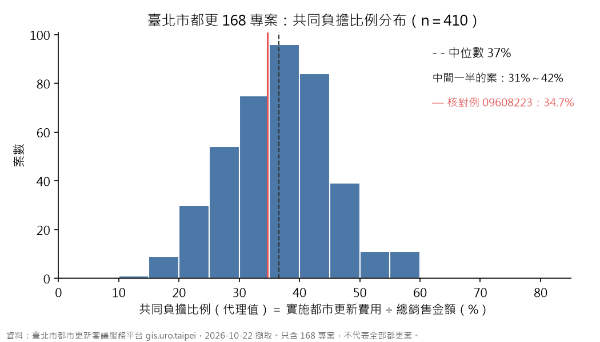
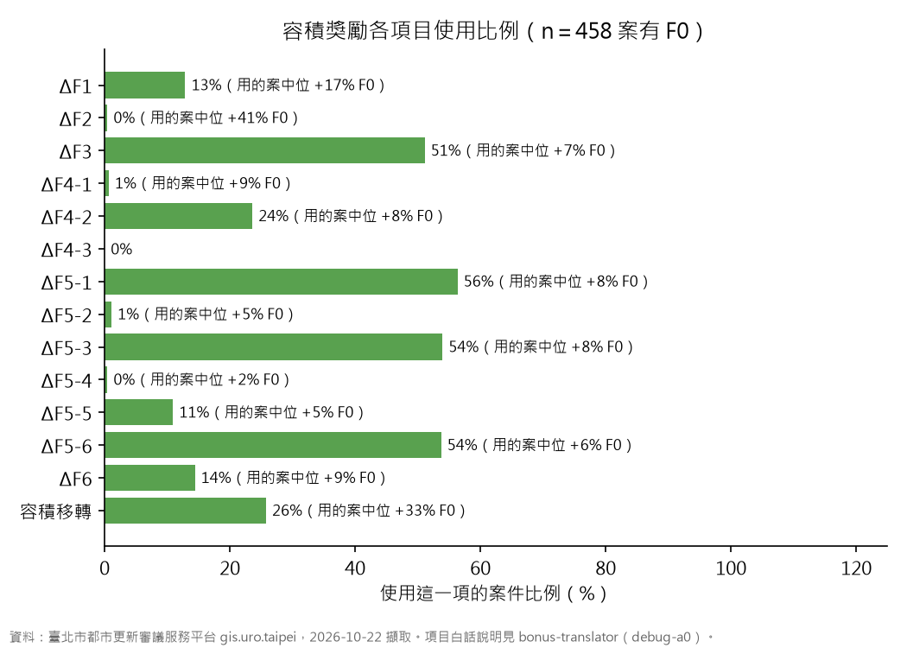

# E3：都更審議平台 168 專案逐案經濟事實表

- 作者：debug-e3。統籌：debug-6f。日期：2026-10-22 夜。
- 任務書：`research/issue-06/mvp-variants/README.md` 第 2 節 E3。
- 產出：
  - `out/uro-review-cases.csv`：一案一列（466 案、96 欄）。
  - `out/fig-burden-ratio.png`、`out/fig-bonus-items.png`：給 34、a0 直接引用的圖。
  - `out/uro-review-case-villages.csv`：案 × 里，一案跨多里時拆列，`village_weight` ＝ 1／里數。
  - `out/summary-by-district.csv`、`out/summary-bonus-items.csv`：本報告的統計表。
- 程式：`scripts/`（`uro_http.py` 限速用戶端、`fetch_uro_cases.py` 抓取、`parse_uro_cases.py` 解析、`analyze_uro_cases.py` 統計）。
- 原始回應：`data/raw/extra/renewal/uro-review-cases/<case_id>.json`（不進 git），請求紀錄在同目錄的 `_manifest.json`。

## 0. 一句話

隊友說「更新後經濟效益要問市府」，其實都更處平台每一案都公開了。本表抓下 168 專案 466 案：

- 420 案有費用資料，410 案算得出共同負擔比例（代理值）。全市中位數 **36.5%**，中間一半的案落在 31%～42%【實測】。
- 379 案同時有更新前土地單價與更新後住宅單價。全市中位數：更新前土地每坪 244 萬元，更新後住宅每坪 86 萬元。比值 0.369，也就是**1 坪土地約等於 2.7 坪新房子的價值**【實測；比值的日期口徑見 2.2】。
- 458 案有容積資料。最常用的獎勵是 ΔF5（57%）與 ΔF3（51%）；有拿獎勵的案，獎勵容積的中位數是 F0 的 26%【實測】。

這些數字只代表 168 專案，不代表全部都更案（見第 5 節）。

## 1. 資料從哪來

### 1.1 列表

都更處「都市更新審議服務平台」（https://gis.uro.taipei）沒有全部案件的公開列表。

- 「案件進度查詢」（`R_progress.aspx`）只能依地段地號、門牌、路名查，不能列出全部【實測 2026-10-22，讀頁面原始碼】。
- 「168 專案查詢」（`P_project168.aspx`）有全列表。頁面用 `POST ashx/Get_project168.ashx`（`type=project168&pageIndex=0&pageSize=3000`）載入，1 個請求拿到 466 案【實測 2026-10-22】。
- 所以本表**只含 168 專案 466 案**。非 168 案沒有抓。

### 1.2 逐案欄位

詳細頁 `r_progress_detail.aspx?case_id=<id>` 本身是空殼，欄位由約 15 支 ashx 用 `POST case_id=<id>` 填入。本表用其中 6 支【實測，讀頁面 JS】：

| 端點 | 內容 | 本表欄位（例） |
|---|---|---|
| `Get_project168_sixth` | 費用資料 | `land_price_before_per_ping`（更新前土地平均單價）、`res_price_after_per_ping`（更新後住宅樓層平均單價）、`parking_price_after_each`、`cost_rebuild`、`cost_rights_transform`、`cost_loan_interest`、`cost_tax`、`cost_management`、`cost_total`（實施都市更新費用） |
| `Get_project168_fourth` | 獎勵資料 | `far_F_m2`、`far_F0_m2`、`dF1_m2`～`dF6_m2`（含 ΔF4-1～4-3、ΔF5-1～5-6）、`bonus_cap_rule`（獎勵上限規定） |
| `Get_project168_third` | 基地與權屬 | `base_area_m2`、`households_before`（原戶數）、`sales_total`（總銷售金額）、公私有土地面積、所有權人數、使用分區 |
| `Get_project168_First` | 基本資料 | `town_name`、`village_names_raw`（行政里）、`define_way`、`define_date`、`progress`、`implementer`、`planner`、`designer` |
| `Get_project168_fifth` | 建築量體 | `total_floor_m2`、`units_residential`（住戶單元數）、`max_floors`、`far_transfer_m2`（容積移轉） |
| `get_project168_top` | 日期 | `apply_date`（申請日）、`approve_date`（核定日） |

不存的欄位：實施者、規劃與設計單位的電話與地址（任務書規定）。公司與事務所名稱有存（法人或事業名稱）。名稱欄只填了個人姓名的（目前 1 筆，設計單位），改成 `(personal name removed)`。

### 1.3 抓取紀律

- 一次一個請求，間隔 ≥4.2 秒（跨程式執行也算），遇到非 200 或連續 3 次空回應就停。
- 上限：原定 1,500，debug-6f 10/22 夜放寬到 2,900，讓 6 支端點全抓。
- 實際用量：2,803 個請求。2,802 個回 200，1 個 ConnectionError（10/22 01:12，`fourth` 端點）。
- 遇到錯誤時：程式照規則停下。我打 example.com 確認本機網路正常，等 15 分鐘後送 1 個首頁請求，回 200 才續抓，間隔改成 6 秒。續抓後沒有再出錯。
- 時間：00:37 開始、01:12～01:28 暫停、05:13 抓完。6 支端點 466 案全部抓到。
- 沒有登入、沒有驗證碼、沒有抓計畫書 PDF 與照片（`seventhbefore`、`seventhafter` 是照片端點，不抓）。

## 2. 欄位怎麼讀

### 2.1 計畫類型與同一基地

- 同一基地常有多個 case_id：事業計畫案、權利變換計畫案、之後的「變更（第 N 次）」案。每個 case_id 保留自己一列。
- `plan_type`：從案名判斷。`business`（只有事業計畫）、`rights`（只有權利變換）、`business+rights`（併送）。
- `revision`：`擬訂` 或 `變更`。
- `site_group`：案名的「區＋段＋小段＋首筆地號」，例如 `南港區新光段二小段134`。同組的列是同一基地，下游可以合併【推論：首筆地號相同就當同一基地；地號重編的案子可能分到兩組】。

### 2.2 單價的日期

平台不顯示估價基準日。同一基地的事業計畫案（09503232，2006 年申請）與權變案（09503233，2022 年申請），更新前土地平均單價差 3.7 倍（52.8 萬對 196 萬元／坪）【實測】。所以比較單價前要先看日期：

- `price_date_proxy`：依序取 top 的申請日、top 的核定日、168 列表備註的「核定公告」日。
- `date_source`：記錄用了哪一個。
- 這是代理值，不是估價基準日【推論】。

### 2.3 共同負擔比例（代理值）

- 定義：`burden_ratio_proxy` ＝ 實施都市更新費用 ÷ 總銷售金額 ＝ `cost_total` ÷ `sales_total`（ashx 欄位 `Urban_Renew_Fee ÷ pc_afterUpdTotalValue`）。
- 核對例：09608223 ＝ 3,155,750,161 ÷ 9,088,449,737 ＝ **34.7%**【實測】。
- 為什麼是代理值：`pc_afterUpdTotalValue` 在頁面上的標籤是「總銷售金額」，不是權利變換的「更新後總權利價值」。兩者口徑可能不同（例如車位、是否含實施者分回部分）【推論】。

### 2.4 單價比

- `price_ratio_after_res_to_before_land` ＝ 更新後住宅樓層平均單價 ÷ 更新前土地平均單價。
- 分子是每坪**樓地板**，分母是每坪**土地**，所以比值小於 1 是正常的。它不是「房價漲幾倍」。

## 3. 結果

### 3.1 案數

| 項目 | 案數 |
|---|---|
| 168 專案全部 | 466 |
| 有費用資料（單價或費用合計不是空的） | 420 |
| 有更新前、更新後單價兩個都有 | 379 |
| 算得出共同負擔比例（排除 4 個異常值後） | 410 |
| 有容積資料（F0 不是空的） | 458 |
| 落得到里（`village_code`） | 461 |

| 計畫類型 | 案數 | 有費用資料 |
|---|---|---|
| 只有事業計畫（`business`） | 170 | 146 |
| 事業計畫＋權利變換併送（`business+rights`） | 226 | 208 |
| 只有權利變換（`rights`） | 70 | 66 |

- 466 案分屬 295 個基地（`site_group`）。
- 5 案沒有里：2 案的平台欄位是空的，3 案只填了區或地段【實測】。
- 4 案跨 2～3 個里，拆列後權重 1／里數。

### 3.2 共同負擔比例（代理值）



- 全市：中位數 36.5%，p25 31.0%，p75 42.2%，p10 25.2%，p90 46.7%（n＝410）【實測】。
- 核對例：09608223 ＝ 34.7%，落在中間【實測】。
- 排除的 4 案（`burden_ratio_ok＝False`，原始值仍留在 CSV）：
  - 10001255：529%。總銷售金額 9.9 億，比費用 52.5 億還小。
  - 10510142、11411003、11507018：2.7%～4.9%。總銷售金額 690 億～1,097 億，比同規模的案大一個位數。
  - 判斷：平台填錯位數【推論】。
- 依計畫類型：只有事業計畫 34.5%、併送 37.0%、只有權變 35.4%。差距不大【實測】。
- 給試算器（34）：共同負擔滑桿的預設值可以用 **36.5%**，範圍 25%～47%（p10～p90）。出處寫「臺北市都更 168 專案 410 案，2026-10-22 擷取」。

### 3.3 更新前後單價，依區

`ratio` ＝ 更新後住宅樓層平均單價 ÷ 更新前土地平均單價。分子是每坪樓地板，分母是每坪土地（見 2.4）。

| 區 | 案數 | 比值 p25 | 比值中位數 | 比值 p75 | 更新前土地（萬元／坪） | 更新後住宅（萬元／坪） | 共同負擔中位數 |
|---|---|---|---|---|---|---|---|
| 全市 | 379 | 0.27 | 0.37 | 0.45 | 244 | 86 | 36.4% |
| 文山區 | 10 | 0.46 | 0.51 | 0.56 | 112 | 59 | 42.2% |
| 北投區 | 49 | 0.31 | 0.41 | 0.46 | 183 | 73 | 41.9% |
| 南港區 | 33 | 0.37 | 0.40 | 0.47 | 185 | 68 | 42.7% |
| 松山區 | 37 | 0.27 | 0.39 | 0.48 | 280 | 108 | 32.3% |
| 大安區 | 42 | 0.26 | 0.38 | 0.42 | 296 | 123 | 32.5% |
| 士林區 | 49 | 0.29 | 0.37 | 0.44 | 221 | 86 | 34.4% |
| 內湖區 | 27 | 0.31 | 0.37 | 0.53 | 192 | 76 | 37.9% |
| 信義區 | 17 | 0.24 | 0.33 | 0.45 | 304 | 99 | 32.9% |
| 中正區 | 36 | 0.24 | 0.32 | 0.38 | 358 | 109 | 36.4% |
| 中山區 | 43 | 0.21 | 0.28 | 0.43 | 320 | 102 | 33.3% |
| 萬華區 | 14 | 0.21 | 0.28 | 0.41 | 239 | 64 | 42.1% |
| 大同區 | 22 | 0.19 | 0.22 | 0.31 | 310 | 74 | 31.0% |

（依比值中位數由高到低排。原始數字見 `out/summary-by-district.csv`。）

怎麼讀【推論】：

- 比值高（文山、北投、南港）：地價相對低，蓋新房子的價值相對高，1 坪土地換到的新房子坪數比較多。
- 比值低（大同、萬華、中山）：地價高但新房子單價沒有跟著高，1 坪土地換到的新房子坪數比較少。
- 文山區只有 10 案、信義區 17 案、萬華區 14 案，樣本小，只當參考。
- 單價的日期：379 案的申請年中位數是 2021 年。2011～2015、2016～2020、2021 年以後三段的比值中位數都在 0.36～0.37，沒有明顯隨年份變化【實測】。所以依區比較時，日期的影響應該不大【推論】。

### 3.4 容積獎勵各項目使用比例



（n＝458 案有 F0。項目的白話說明請看 debug-a0 的 `bonus-translator/bonus-items.csv`，本表只給數字。）

| 項目 | 用的案數 | 使用比例 | 用的案中，這項佔 F0 的中位數 |
|---|---|---|---|
| ΔF1 | 59 | 12.9% | 17.0% |
| ΔF2 | 2 | 0.4% | 40.6% |
| ΔF3 | 234 | 51.1% | 7.0% |
| ΔF4 | 110 | 24.0% | 7.7% |
| ΔF4-1 | 3 | 0.7% | 9.4% |
| ΔF4-2 | 108 | 23.6% | 7.7% |
| ΔF4-3 | 0 | 0% | — |
| ΔF5 | 261 | 57.0% | 24.0% |
| ΔF5-1 | 258 | 56.3% | 8.0% |
| ΔF5-2 | 5 | 1.1% | 5.0% |
| ΔF5-3 | 247 | 53.9% | 7.9% |
| ΔF5-4 | 2 | 0.4% | 1.8% |
| ΔF5-5 | 50 | 10.9% | 4.8% |
| ΔF5-6 | 246 | 53.7% | 6.0% |
| ΔF6 | 66 | 14.4% | 8.9% |
| 容積移轉 | 118 | 25.8% | 33.2% |

- 獎勵容積比例 (F－F0)／F0：中位數 25.9%，p75 41.1%【實測】。
- p25 是 0：106 案的 F 等於 F0。這些案可能是 F 欄沒填，不一定是沒拿獎勵【推論】。下游要用獎勵比例時，建議排除 F＝F0 的案，或另外標示。
- 容積移轉不算在 ΔF 裡，但用的案佔 F0 的中位數有 33%，是單項最大的。

## 4. 抽查 5 案

方法：`analyze_uro_cases.py` 從原始回應直接讀出欄位，與 CSV 的同一格比對。5 案涵蓋三種計畫類型、四個區（信義、南港、北投、文山）、2017～2025 年申請。

| case_id | 類型 | 原始回應：更新前土地單價／更新後住宅單價／實施費用 | CSV | 原始回應：F／F0 | CSV | 一致 |
|---|---|---|---|---|---|---|
| 09608223 | 併送（變更） | 1,320,000／722,423／3,155,750,161 | 同左 | 18,077.99／13,216.5 | 同左 | ✅ |
| 09503233 | 只有權變 | 1,960,000／944,073／2,856,050,719 | 同左 | 9,649.27／6,638.92 | 同左 | ✅ |
| 10609301 | 只有事業計畫 | 1,415,454／750,818／4,001,075,535 | 同左 | 19,985.64／13,486.5 | 同左 | ✅ |
| 10611283 | 只有權變（變更） | 2,173,622／669,181／413,652,446 | 同左 | 3,303.34／2,436.0 | 同左 | ✅ |
| 10712252 | 併送（變更） | 1,149,200／552,714／309,257,250 | 同左 | 2,783.16／1,980.09 | 同左 | ✅ |

另外，09608223 的欄位與 debug-6f 10/22 在瀏覽器看到的渲染頁一致【實測 debug-6f】。這是唯一一個和平台畫面獨立核對過的案。

## 5. 限制與偏誤

1. **選擇偏誤**：本表只含 168 專案 466 案，不是全部都更案。168 專案是無爭議民辦都更的審議快速通道，事業計畫或權變單送 6 個月、併送 8 個月，以更新處工作日計【文件：[風傳媒 2016](https://www.storm.mg/article/206551)、[公視新聞](https://news.pts.org.tw/article/787053)】。報導稱 168 案需取得 100% 同意，但我沒有讀到官方執行要點【待確認】。所以這些案的共同負擔、單價比，可能和有爭議的一般案不同。
2. **日期**：單價沒有估價基準日，見 2.2。
3. **共同負擔是代理值**，見 2.3。
4. **欄位空白**：早期階段的案子費用欄位常是空的。0 在單價、費用合計、F、F0 這些欄位當成「沒填」處理（改成空值）；ΔF 各項的 0 當成「沒用這項」。
5. **平台填錯**：共同負擔有 4 案超出 5%～80%，見 3.2；里名有 2 個錯字（啤頭里→埤頭里、新西里→西新里），用同區唯一相近的里名對應，`uro-review-case-villages.csv` 的 `village_alias_from` 欄有記錄【推論】。
6. **抽查只驗解析**：第 4 節比的是原始回應與本表，驗的是我的解析程式，不是平台資料本身。沒有用瀏覽器截圖，因為一次載入詳細頁會平行發出約 20 個請求，違反「一次一個」的規則。debug-6f 10/22 用瀏覽器看過 09608223 的渲染頁，與本表一致【實測 debug-6f】。

## 6. 給 debug-6f（搬進 pipelines 時）

### 6.1 重跑（不重新抓）

從 repo 根目錄執行這一行。它只讀 `data/raw/extra/renewal/uro-review-cases/` 已存的原始回應，不連網：

```bash
uv run python -X utf8 research/issue-06/mvp-variants/uro-cases/scripts/parse_uro_cases.py && uv run python -X utf8 research/issue-06/mvp-variants/uro-cases/scripts/analyze_uro_cases.py
```

- 產出：`out/` 底下 2 張 CSV 事實表、2 張統計 CSV、2 張 PNG。
- 不需要新套件（pandas、matplotlib 已在 `uv` 環境裡）。
- 作者驗證：2026-10-22 05:15 在全部資料上跑過，6 個檔都有產生，結束碼 0【實測】。

### 6.2 重新抓（要網路）

```bash
uv run python -X utf8 research/issue-06/mvp-variants/uro-cases/scripts/fetch_uro_cases.py list
uv run python -X utf8 research/issue-06/mvp-variants/uro-cases/scripts/fetch_uro_cases.py cases --endpoints sixth,fourth,third,First,fifth,top
```

- 程式會跳過已經存過的端點，所以中斷後可以接著跑。
- 466 案 × 6 支約 2,800 個請求，每個間隔 4.2 秒，約 3.3 小時。

### 6.3 搬進 pipelines 的建議

1. `uro_http.py`、`fetch_uro_cases.py` → `pipelines/fetch/`（`fetch_uro_cases.py` 改成 import `pipelines.fetch.uro_http`）。
2. `parse_uro_cases.py` → `pipelines/stage/stage_uro_review_cases.py`，輸出改成 `data/staged/renewal/uro-review-cases.csv` 與 `uro-review-case-villages.csv`（現在寫 `out/`）。
3. `analyze_uro_cases.py` 留在研究資料夾（只有這份報告用）。
4. 三支程式的 `sys.path.insert` 搬進 `pipelines/` 後可以拿掉，改用 `-m pipelines.<層>.<檔名>` 執行。
5. `data/catalog.json` 要新增一筆來源（slug 建議 `uro-review-cases`）。catalog 只有整合者 debug-83 能改。

### 6.4 已搬進 pipelines（統籌 2026-10-22 05:3x）

- `pipelines/stage/stage_uro_review_cases.py`：薄殼，從檔案載入 `scripts/parse_uro_cases.py` 並把輸出指到 `data/staged/renewal/`。跑法 `uv run python -X utf8 -m pipelines.stage.stage_uro_review_cases`，不連網。
- 產出 `data/staged/renewal/uro-review-cases.csv`、`uro-review-case-villages.csv`，與 `out/` 逐位元相同【實測，cmp】。
- 抽查 3 案（09608223、10511082、10301282）的 `cost_total`、`sales_total`、`burden_ratio_proxy`、`land_price_before_per_ping` 對原始回應（sixth 的 `Urban_Renew_Fee`、`Renew_Mon1`；third 的 `pc_afterUpdTotalValue`）全部一致【實測】。
- 欄位字典以本報告第 2 節為正本；`data/marts/README.md` 與 `data/catalog.json` 是共用檔，待整合者 debug-83 加一筆（slug 建議 `uro-review-cases`）。

## 7. 待使用者處理

（目前沒有。）
